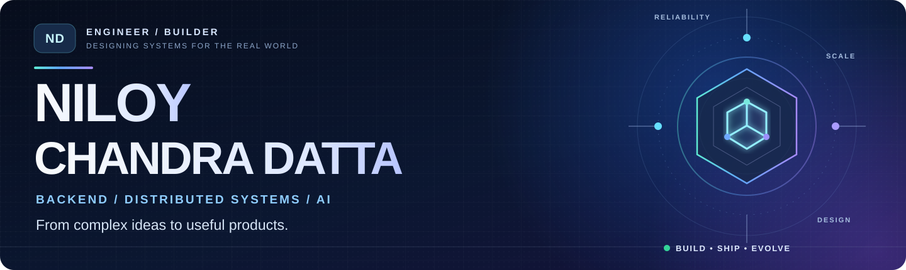
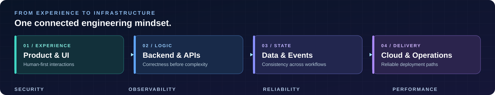

<!-- GitHub profile README | Designed for github.com/niloy-datta -->

  

  <h3>Engineering reliable systems. Designing useful products. Exploring what comes next.</h3>

  
<strong>Software Engineering · Distributed Systems · AI/ML · Product Development</strong>

  
  
  

   
  Build with purpose &nbsp;·&nbsp; Engineer with care &nbsp;·&nbsp; Keep improving

---

### 01 / THE PERSON BEHIND THE CODE

I'm **Niloy Chandra Datta** — a CSE undergraduate, software developer, and founder building at the intersection of **backend engineering, practical AI, and product design**.

I enjoy taking an idea all the way from a sketch to a working product: understanding the problem, shaping the architecture, writing the code, and improving it after launch. Alongside engineering, my **Business Development work at SHL Group** keeps me close to real operational and customer needs.

<table>
<tr>
<td width="50%" valign="top">
  <strong>🔭 What I'm working on</strong>
  <ul>
    <li>Java / Spring Boot backend systems</li>
    <li>Full-stack web and mobile products</li>
    <li>Reliable workflows, APIs, and integrations</li>
    <li>AI-powered applications for real-world problems</li>
  </ul>
</td>
<td width="50%" valign="top">
  <strong>🧠 What I'm exploring</strong>
  <ul>
    <li>ML Systems &amp; Distributed AI</li>
    <li>Distributed architecture and concurrency</li>
    <li>Earth observation and agricultural intelligence</li>
    <li>Research collaborations and graduate study</li>
  </ul>
</td>
</tr>
</table>

### 02 / FEATURED BUILDS

Selected products and engineering explorations. Some source repositories are private; the links below lead to available product pages.

<table>
<tr>
<td width="50%" valign="top">
  <h3>🌱 AgriLume AI</h3>
  
<strong>Environmental data → agricultural intelligence</strong>

  
Satellite and geospatial data-driven experiences for field insights, resilience, and better agricultural decisions.

  
<code>Next.js · Python · Earth Observation · AI</code>

  
<a href="https://agrilume-web.vercel.app/"><strong>Explore project ↗</strong></a>

</td>
<td width="50%" valign="top">
  <h3>🚀 Echoes Beyond Earth</h3>
  
<strong>Interactive exploration powered by science</strong>

  
A space-exploration game built around missions, environments, and learning through interaction.

  
<code>Next.js · TypeScript · Three.js · NASA Data</code>

  
<a href="https://echoes-beyond-earth.onrender.com/"><strong>Explore project ↗</strong></a>

</td>
</tr>
<tr>
<td width="50%" valign="top">
  <h3>🛡️ ATLAS</h3>
  
<strong>Identity-first workforce infrastructure</strong>

  
A workforce platform exploring verified identities, authorization boundaries, credential workflows, and trusted operations.

  
<code>Backend Architecture · Identity · Authorization</code>

  
<a href="https://atlas-nine-taupe.vercel.app/"><strong>Explore project ↗</strong></a>

</td>
<td width="50%" valign="top">
  <h3>🛒 NovaCommerce</h3>
  
<strong>Transactions that hold up under pressure</strong>

  
A distributed commerce engineering project focused on inventory reservation, concurrency control, and transactional correctness.

  
<code>Distributed Systems · Transactions · Concurrency</code>

  
<em>Private development project</em>

</td>
</tr>
<tr>
<td width="50%" valign="top">
  <h3>🌍 SHL Global</h3>
  
<strong>Technology for international business</strong>

  
Business-oriented web experiences and operations tooling for international logistics, trading, and services.

  
<code>Web Engineering · Business Systems · UX</code>

  
<a href="https://shl-global.vercel.app/"><strong>Explore project ↗</strong></a>

</td>
<td width="50%" valign="top">
  <h3>✦ KADHAVIRA LABS</h3>
  
<strong>Ideas → software → products</strong>

  
My independent technology studio direction, spanning software, AI, SaaS, cloud, and research-driven product work.

  
<code>Product · Design · Software · Research</code>

  
<a href="https://nbd-website-wine.vercel.app/"><strong>Explore studio ↗</strong></a>

</td>
</tr>
</table>

  

### 03 / ENGINEERING TOOLKIT

  

 

| Discipline | Tools & technologies |
|:--|:--|
| **Backend & APIs** | Java · Spring Boot · Python · FastAPI · REST · SQL · JPA / Hibernate |
| **Frontend & mobile** | TypeScript · React · Next.js · Tailwind CSS · Flutter |
| **Data & persistence** | PostgreSQL · MySQL · Redis · SQLite |
| **Infrastructure** | Docker · Linux · AWS · Git · GitHub · CI/CD |
| **Product & design** | Figma · UI/UX · Prototyping · Product Thinking |

### 04 / HOW I THINK ABOUT SYSTEMS

  

> **The goal isn't more technology. It's the right technology, working together to solve a real problem.**

I care about clear boundaries, understandable code, thoughtful UX, secure defaults, testable behavior, and deployment paths that people can trust.

### 05 / OPEN SOURCE & LEARNING IN PUBLIC

Beyond private product work, I keep sharpening fundamentals through **Java, data structures, algorithms, and software engineering experiments**.

[**Explore my public work ↗**](https://github.com/niloy-datta?tab=repositories) &nbsp;·&nbsp; [**Browse DSA projects ↗**](https://github.com/niloy-datta/data-structures-and-algorithms-python)

### 06 / LET'S BUILD SOMETHING MEANINGFUL

I'm interested in conversations around **backend platforms, ML systems, distributed AI, developer tooling, climate/agriculture technology, and research collaboration**.

  <h3>Good software begins with a good problem.</h3>
  
Let's turn one into something useful.

  
  
  

    
  Built with curiosity. Refined with care. — Niloy

